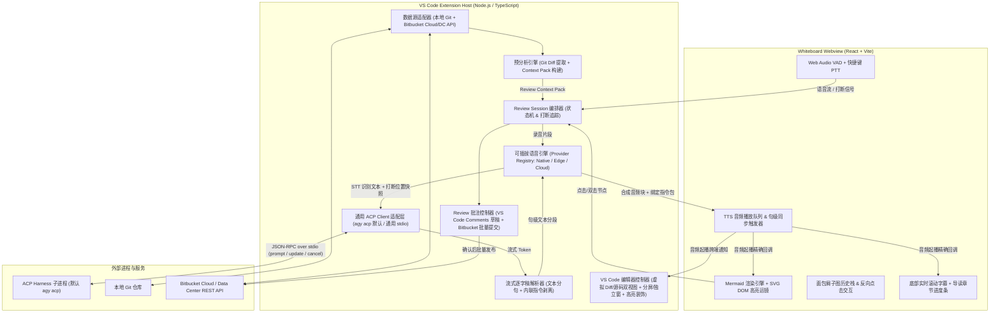
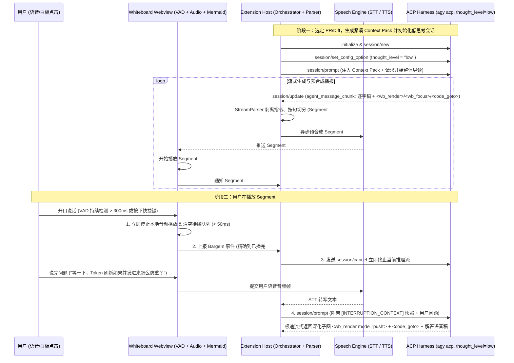

# VS Code 语音交互式白板 PR / Diff 导读插件（Review Agents）技术架构与实施计划

- **日期**：2026-11-20
- **任务目录**：`docs/tasks/20261120-acp-voice-review-extension`
- **目标形态**：VS Code Extension（TypeScript Extension Host + React Whiteboard Webview）
- **核心定位**：像一位坐在旁边的资深工程师一样，一边在独立白板上画架构/流程图并动态聚焦重点，一边自动帮你切到对应的代码 Diff 区域高亮讲解；支持全双工语音对话、随时开口打断追问、点击白板反向导航，以及语音记下 Review 批注并在最后一键推送到 Bitbucket PR 或导出报告。

---

## 1. 核心设计决策总览

基于前期需求对齐，本方案确立以下关键技术决策：

| 维度 | 选定方案 | 核心收益 |
| :--- | :--- | :--- |
| **Agent 接入协议** | 标准 **ACP (Agent Client Protocol, JSON-RPC 2.0 over stdio)**；默认预设适配 `agy acp`（Antigravity CLI），同时抽象通用 Profile 支持随时切换至 `claude-code-acp`、`codex-acp`、`gemini --acp` 等任意 Harness | 复用本地已有 Agent 鉴权与代码理解能力，不绑定单一模型厂商 |
| **低延迟低思考保障** | **「预分析 Context Pack + 极速低思考导读」双阶段架构**：启动时静态提取 Git Diff 结构并生成紧凑导读地图；会话期通过 ACP 将 `thought_level` 锁定为 `low`，优先基于 Context Pack 毫秒级直出，仅在追问深水区细节时按需读文件 | 彻底解决复杂 PR「要么思考半天不说话，要么不看代码瞎编」的矛盾 |
| **音画同步与指令协议** | **流式内联轻量指令（Inline Directives）**：模型流式输出口播逐字稿，穿插极简标签（如 `<wb_render>`、`<wb_focus id="B"/>`、`<code_goto/>`）；插件按句切分送入 TTS 预合成队列，并在该句音频**实际起播瞬间**触发画布与编辑器动作 | 不增加模型 thinking 负担，不依赖特定商业 TTS 的词级时间戳即可做到严格音画同步 |
| **白板渲染与深化交互** | **单次 Mermaid 渲染 + 前端 SVG DOM 动态聚焦/平滑运镜 + 顶部面包屑子图栈**：模型只输出极简节点 ID，由前端自动完成节点发光、非焦点压暗与 `svg-pan-zoom` 镜头平移；深化子模块时压栈并保留面包屑随时回退；支持点击节点提问/双击跳代码 | 零重排闪烁、零额外模型推理负担，兼顾全局视野与局部钻取 |
| **语音引擎与打断机制** | **可插拔 Provider 架构 + 零配置免费兜底 + 全双工 VAD 打断**：MVP 内置 Edge Neural TTS / macOS 原生语音作为免 Key 开箱方案，预留 OpenAI / 豆包 / Deepgram / ElevenLabs 接口；Webview 内置 VAD 检测到开口即刻毫秒级停播、发 `session/cancel`，并将「已播文本 + 未播进度 + 当前白板节点 + 当前代码行」注入下一轮上下文 | 开箱即用无需配 Key，打断响应 < 50ms，Harness 精准感知被打断的位置 |
| **代码源与视图布局** | 支持 **本地 Git 分支/Commit Diff** 与 **Bitbucket PR（兼容 Cloud 与 Server/Data Center）**；编辑器默认采用 **原生 Diff 视图 + 一键切换单文件源码视图**（基于虚拟 `review-git://` 文档，无需污染本地工作区）；触发代码跳转时自动左右分屏，并支持将白板**弹出至独立窗口**放副屏常驻 | 适配真实企业研发流，双屏/单屏体验均顺滑 |
| **语音批注闭环** | 语音触发记录问题时，先落入 **VS Code 原生 Comments 面板与代码行内草稿（Draft）**，支持人工审校编辑，结束后一键批量发布至 Bitbucket PR 行级评论或导出 Markdown 清单 | 避免语音识别错字直接污染线上 PR，安全可控 |

---

## 2. 系统总体架构与核心工作流

### 2.1 模块分层架构图



### 2.2 全双工语音导读与毫秒级打断时序



---

## 3. 核心模块详细设计

### 3.1 工程目录结构

在当前仓库根目录下采用清晰的模块化双端结构（Extension Host + Webview UI）：

```text
review-agents/
├── package.json                  # VS Code 插件清单 (commands, configuration, menus, activationEvents)
├── tsconfig.json                 # Extension Host TS 配置
├── esbuild.mjs                   # Extension Host 打包脚本
├── src/                          # VS Code Extension Host 源码 (Node.js 环境)
│   ├── extension.ts              # 插件激活入口与命令注册
│   ├── acp/                      # 通用 ACP 客户端模块
│   │   ├── AcpClientManager.ts   # stdio 进程管理、JSON-RPC 通信、重连与生命周期
│   │   ├── profiles.ts           # 内置预设 (agy acp 默认、claude-code-acp、codex-acp、自定义命令)
│   │   └── PermissionGuard.ts    # Review 期间工具权限守卫 (自动放行只读文件/git，拦截写文件与危险命令)
│   ├── context/                  # Diff 数据源与预分析引擎
│   │   ├── GitService.ts         # 本地分支/Commit Diff 提取、hunk 解析、git fetch
│   │   ├── BitbucketService.ts   # Bitbucket Cloud (v2.0) & Server/DC (v1.0) 自动识别与 API 客户端
│   │   └── ContextPackBuilder.ts # 预分析构建器：生成变更地图、模块分组、导读章节大纲
│   ├── orchestrator/             # 导读核心状态机与同步引擎
│   │   ├── ReviewSession.ts      # 会话主控制器、章节状态、打断上下文快照拼接
│   │   ├── DirectiveParser.ts    # 流式标签状态机解析器 + 中英文分句器 (Utterance Chunker)
│   │   └── PromptTemplates.ts    # 导读 System Prompt、内联指令规范与打断恢复模板
│   ├── speech/                   # 可插拔语音引擎抽象与内置实现
│   │   ├── types.ts              # ISttProvider / ITtsProvider 接口定义
│   │   ├── SpeechRegistry.ts     # Provider 注册与配置热切换
│   │   ├── tts/
│   │   │   ├── EdgeNeuralTts.ts  # 免费免 Key 高自然度中英混读 TTS (默认首选)
│   │   │   ├── SystemNativeTts.ts# macOS `say` / 系统原生离线兜底 TTS
│   │   │   └── OpenAiCompatTts.ts# 可选云端流式 TTS 扩展槽 (OpenAI / 豆包 / ElevenLabs)
│   │   └── stt/
│   │       ├── SystemNativeStt.ts# macOS 原生语音识别辅助器 / 本地 Whisper CLI 免费免 Key 兜底
│   │       └── OpenAiCompatStt.ts# 可选云端低延迟 STT 扩展槽 (OpenAI / Deepgram / 豆包)
│   ├── vscode-ui/                # VS Code 原生界面控制器
│   │   ├── WhiteboardPanel.ts    # WebviewPanel 管理、自动分屏 (Beside) 与弹出独立副屏窗口
│   │   ├── GitContentProvider.ts # `review-git://` 虚拟只读文件系统 (支撑免 checkout 原生 Diff)
│   │   ├── CodeNavigator.ts      # Diff/源码智能双视图跳转、行区间高亮框、讲解气泡装饰器
│   │   └── ReviewComments.ts     # VS Code Comments API 草稿管理、Bitbucket 批量提交与 Markdown 导出
│   └── shared/                   # Extension Host 与 Webview 共享消息协议类型
│       └── protocol.ts
└── webview-ui/                   # 白板前端工程 (React + TypeScript + Vite)
    ├── package.json
    ├── vite.config.ts
    └── src/
        ├── App.tsx
        ├── components/
        │   ├── TopToolbar.tsx        # 数据源信息、视图切换、弹出新窗口按钮、Provider 状态
        │   ├── BreadcrumbStack.tsx   # 子图钻取面包屑导航栈 (`全局架构 > 鉴权模块 > ...`)
        │   ├── MermaidStage.tsx      # Mermaid 渲染容器 + SVG DOM 节点发光/压暗 + svg-pan-zoom 运镜
        │   ├── SubtitleHud.tsx       # 实时滚动字幕 + 章节进度条 (`2/5 核心逻辑变更`)
        │   └── VoiceControlBar.tsx   # VAD 波形指示灯、静音/按住说话切换、当前选中节点胶囊
        └── hooks/
            ├── useAudioSyncQueue.ts  # Web Audio 顺序播放队列 + 精确起播指令回调 + 毫秒级清空停播
            └── useVoiceVad.ts        # 麦克风采集 + VAD 语音活动检测 + 防回声误触门限控制
```

---

### 3.2 数据源接入：本地 Git Diff 与 Bitbucket (Cloud / Data Center) 双模适配

1. **统一入口选择器（QuickPick 向导）**：
   - **模式 A：本地分支 / Commit Diff**：自动列出本地与远程分支（默认以 `main`/`master`/`develop` 为 base，当前分支 `HEAD` 为 head），也支持任选两个 Commit/Tag。
   - **模式 B：Bitbucket PR**：
     - 自动解析当前仓库 `git remote -v`：
       - 若域名为 `bitbucket.org`，自动启用 **Bitbucket Cloud REST API 2.0**（`/2.0/repositories/{workspace}/{repo_slug}/pullrequests/{id}`）。
       - 若为自建域名，自动启用 **Bitbucket Server / Data Center REST API 1.0**（`/rest/api/1.0/projects/{projectKey}/repos/{repoSlug}/pull-requests/{id}`），同时允许在配置中手动覆盖 Base URL。
     - 认证凭据通过 VS Code 官方安全的 `SecretStorage` 存储（支持 HTTP Access Token / Personal Access Token / App Password），绝不明文写入配置文件。
     - 拉取 PR 标题、描述、作者、源分支与目标分支 Commit SHA 后，在本地静默执行 `git fetch origin <source_sha> <target_sha>`，后续所有 Diff 和源码读取直接走本地 Git 对象库，实现毫秒级零网络卡顿跳转。

---

### 3.3 双阶段导读策略：预分析 Context Pack 与极速低思考响应

为了确保语音问答期间模型响应如真人般迅速（TTFT < 800ms），避免每问一句话都去跑十几秒工具调用或深度思考：

1. **阶段一：启动期轻量预分析（Context Pack 构建，约 2~5 秒）**
   - 本地 `GitService` 瞬间提取：
     - PR 元信息（标题、描述、关联 Issue）或 Commit Messages 列表；
     - `git diff --numstat` 与变更文件树（新增/修改/重命名/删除）；
     - 每个变更文件的 Hunk 头部上下文（`@@ -a,b +c,d @@ function signature`）及核心变更摘要（对于中小型 PR 直接附带压缩后的关键 Hunk，对于超大型 PR 按目录/模块聚类摘要并标注行号索引）。
   - 组装成结构化的 **`ReviewContextPack`**（控制在 3k~8k Tokens 以内），内含：变更模块拓扑、推荐导读章节划分（如 `1. 背景与架构意图 -> 2. 数据结构变更 -> 3. 核心业务流改造 -> 4. 边界与测试`）、文件行号映射索引。

2. **阶段二：实时语音导读期（锁定最低 Thinking Effort）**
   - 建立 ACP 会话后，插件自动检测 `session/new` 返回的 `configOptions` 与 `models`：
     - 对 `agy acp`（已验证支持 `configOptions` 中的 `id: "thought_level"`）：立即调用 `session/set_config_option` 将 `thought_level` 设为 `"low"`（或选用 `:low` 路由模型）；同时通过 `_meta.antigravity.systemPrompt.append` 注入导读规则（对其他不支持该 `_meta` 的通用 ACP Harness，自动退化为首轮会话上下文注入）。
   - **按需渐进式读取**：90% 的宏观导读、模块串联和已摘要代码讲解直接命中 `ReviewContextPack`，无需调任何工具即可流式直出；仅当用户针对某处深层细节追问（例如「帮我看下第 120 行调用的那个外部 helper 函数内部怎么写的」）时，Harness 才通过 ACP 标准 `fs/read_text_file` 快速读取对应文件片段。

---

### 3.4 流式内联指令协议（Inline Directives）与音画同步机制

模型被约束为输出**纯口语化导读逐字稿 + 极简内联单行/块级指令标签**，严禁输出无关 Markdown 废话代码块。

#### 内联指令集规范

| 指令标签 | 示例 | 触发时机与前端动作 |
| :--- | :--- | :--- |
| `<chapter>` | `<chapter index="1" total="4" title="整体架构与改动动机"/>` | 随紧邻下一句语音起播时，更新白板底部章节进度条 |
| `<wb_render>` | `<wb_render id="overview" title="鉴权链路改造" mode="replace" map='{"Auth":"src/auth.ts:40-85"}'>flowchart LR ...</wb_render>` | 渲染新 Mermaid 图；`mode="replace"` 替换当前层，`mode="push"` 压入面包屑子图栈（用于深化某一块）；可选 `map` 属性绑定节点与源码位置供双击跳转 |
| `<wb_focus>` | `<wb_focus id="Auth" edge="Gateway->Auth"/>` | **零重渲染、零闪烁**：前端在当前 SVG 中定位节点 `Auth`，添加高亮脉冲光晕、压暗其余非焦点节点，并通过 `svg-pan-zoom` 平滑平移缩放镜头对准该节点 |
| `<wb_pop/>` / `<wb_clear/>` | `<wb_pop/>` | 从深化子图退回上一级父架构图 / 清空当前高亮聚焦状态 |
| `<code_goto>` | `<code_goto file="src/auth.ts" lines="42-68" view="diff" label="并发刷新锁逻辑"/>` | 随该句语音起播时：若尚未分屏则自动将白板移至右侧分栏，在左侧打开原生 Diff（或 `view="source"` 单文件源码），滚动至 42-68 行并渲染高亮背景框与讲解标签 |
| `<review_note>` | `<review_note file="src/auth.ts" line="55" severity="warning">异常分支未释放 refreshLock</review_note>` | 当用户口头要求「记个问题/留个评论」时，在对应文件与行号创建本地草稿批注并弹出轻提示 |

#### 句级流式切片与预合成同步（`DirectiveParser` + `useAudioSyncQueue`）

1. **流式状态机解析**：ACP 每吐出一个 `agent_message_chunk`，`DirectiveParser` 实时识别 `<...>` 标签：
   - 遇到指令标签时先暂存至 `pendingDirectives` 缓冲区，绝不送入 TTS 朗读；
   - 遇到自然语言文本时累积并在标点边界（`。！？；.!?;` 或换行，且最小字数 >= 8 字以防碎句）切分为独立的 `UtteranceSegment`：
     ```ts
     interface UtteranceSegment {
       segmentId: string;
       turnId: string;
       spokenText: string;            // 纯口播文本（同时用于实时字幕展示）
       directivesBefore: Directive[]; // 在本句音频第 0ms 起播瞬间立即执行的指令
       directivesAfter: Directive[];  // 在本句播完瞬间执行的收尾指令
     }
     ```
2. **流水线并发预合成**：当第 `1` 句正在播放时，后台并行调用 TTS 合成第 `2、3` 句音频 Buffer 推入 Webview 队列，实现句间零停顿衔接。
3. **严格起播同步**：只有当 Webview 的 `AudioBufferSourceNode.start()` 真正开始播放 `Segment #k` 时，才执行 `Segment #k.directivesBefore`（画图、聚焦节点、通知 Extension Host 跳转代码行），彻底杜绝「模型 2 秒吐完全部文字导致画面早就跳到结尾，语音还在讲开头」的音画脱节问题。

---

### 3.5 可插拔语音引擎与全双工精确打断机制

#### 1. 语音 Provider 架构与 MVP 免配置兜底
定义标准接口 `ITtsProvider` 与 `ISttProvider`，用户在 VS Code Settings 中可一键切换：
- **MVP 默认开箱方案（零 API Key 即可跑通全流程）**：
  - **TTS 默认**：`EdgeNeuralTtsProvider`（基于免费 Edge Neural WebSocket 语音合成，支持中英技术术语自然混读、倍速调节如 `1.15x`），离线断网时自动降级为 `SystemNativeTtsProvider`（macOS `say` 生成音频流 / Web Speech API）。
  - **STT 默认**：`SystemNativeSttProvider`（macOS 下提供轻量 Swift `SFSpeechRecognizer` 命令行桥接或本地 `whisper-cli` 自动探测，并兼容 Webview 语音识别兜底），无需付费配 Key 即可直接开口对话。
- **云端增强预留接口**：内置标准化 `OpenAiCompatibleStt/Tts` 配置项，后续填入 OpenAI、火山引擎豆包、Deepgram 或 ElevenLabs API Key 即可无缝升级。

#### 2. 全双工 VAD 监听与防回声误触
- Webview 集成基于 WebAssembly 的轻量级语音活动检测（Silero VAD / 能量频谱双门限 VAD）及快捷键支持（`Space` 切换静音 / 按住说话）：
  - 开启浏览器原生 `echoCancellation: true, noiseSuppression: true, autoGainControl: true` 音频约束；
  - 在 TTS 播报期间自动略微提高 VAD 触发阈值并要求连续人声持续 `>= 300ms` 才判定为有效打断（过滤敲键盘声、咳嗽声或扬声器轻微回声），同时界面保留一键切换「仅按键打断」开关供外放嘈杂环境使用。

#### 3. 精确打断状态回传（让 Harness 知道在哪里被打断）
一旦触发打断：
1. Webview 立即调用 `audioSource.stop()` 清空音频队列（体感延迟 `< 50ms`），记录当前播放进度（精确到 `Segment #k` 及已播放时长占比估算的字符偏移量）。
2. Extension Host 立即向 ACP 发送 `session/cancel` 终止当前回合推理。
3. 当用户说完打断问题后，Extension Host 在发给 ACP 的下一轮 `session/prompt` 前自动拼入结构化状态快照：
   ```xml
   <interruption_context>
     <status>用户在你讲解中途开口打断了播报</status>
     <spoken_already>（本轮用户实际已听到的逐字稿内容）</spoken_already>
     <unspoken_cut_off>（已被截断、用户尚未听到的剩余草稿摘要）</unspoken_cut_off>
     <whiteboard_state diagram_id="auth-flow" focused_node="TokenRefresh" stack="overview > auth-flow"/>
     <editor_state file="src/auth/token.ts" lines="42-68" view="diff"/>
   </interruption_context>
   用户刚刚提问：{STT识别出的用户问题}
   （请直接回应用户问题；回答完毕后可询问是否继续刚才未讲完的部分，或直接自然衔接。）
   ```

---

### 3.6 Mermaid 交互白板与 VS Code 智能双视图联动

1. **白板核心视觉与交互（`MermaidStage`）**：
   - **节点高亮与自动运镜**：渲染 Mermaid 生成 SVG 后，自动建立逻辑节点 ID（如 `Auth`）到 SVG `<g class="node" id="flowchart-Auth-...">` 及关联边 `<path>` 的索引。收到 `<wb_focus id="Auth"/>` 时，为其挂载高亮 CSS 类（主题色描边发光 + 微幅呼吸动画），其余节点透明度降至 `0.35`，并计算目标节点 BBox 平滑驱动 `svg-pan-zoom` 居中放大。
   - **Mermaid 语法容错自愈**：若大模型偶发输出非法 Mermaid 语法（如括号未转义），前端捕获 `mermaid.parse()` 异常后保持上一帧正常画布不白屏，同时静默正则修复常见未加引号括号问题或在后台请求快速修正。
   - **面包屑钻取栈（`BreadcrumbStack`）**：顶栏展示 `全局变更总览 > 鉴权服务改造 > 并发锁状态机`，点击任意上级面包屑立即回退画布视图并同步告知会话上下文。
   - **反向点击交互**：
     - **单击节点**：白板底部显示胶囊提示 `已指向节点: [TokenRefresh] — 直接开口提问即可围绕该模块展开`，下一句语音提问自动附带 `<selected_node id="TokenRefresh"/>`。
     - **双击节点**：若该节点带有代码映射（来自 `<wb_render map=...>` 或文件名匹配），立即在左侧编辑器跳转到对应代码文件与行区间。

2. **智能分屏、独立副屏窗口与 Diff/源码双视图（`WhiteboardPanel` + `CodeNavigator`）**：
   - **布局自适应**：刚打开导读时，白板占据当前活动编辑组（大画布纵览全局架构）；首次收到 `<code_goto>` 时，若白板与代码处于同一列，自动将白板移至右侧分栏（`ViewColumn.Beside`），左侧（`ViewColumn.One`）打开代码并保持焦点平滑滚动。
   - **独立窗口支持**：白板顶栏提供 **「弹出至独立窗口」** 按钮，内部调用 `workbench.action.moveEditorToNewWindow` 将白板弹出为 VS Code 原生浮动副屏窗口；一旦处于独立窗口状态，后续所有 `<code_goto>` 均固定在主窗口打开代码，不再重复挤压分屏。
   - **免污染虚拟 Git 双视图**：
     - 注册自定义只读 `TextDocumentContentProvider`（协议头 `review-git://`），直接通过 `git show <commit>:<path>` 按需读取 Base 与 Head 版本内容，**用户无需切换本地分支或暂存手头未提交代码即可 Review 任意 PR**。
     - **默认 Diff 视图**：调用 `vscode.diff(baseUri, headUri, title)` 直观对比增删改，并在右侧（Head 侧）目标行区间叠加醒目的半透明高亮框（`TextEditorDecorationType`）及行尾讲解标签。
     - **一键切单文件源码视图**：顶栏开关或 Agent 指令 `view="source"` 可随时切至单文件视图（优先打开工作区真实文件方便用户顺手 `Go to Definition` 查调用链，若本地未检出该分支则自动回退至 `review-git://head/...` 只读源码视图）。

---

### 3.7 语音批注暂存与 Bitbucket 一键批量发布

1. **草稿采集**：Review 途中用户随时说出「这里记个问题：如果超时会导致死锁」或点击 HUD 上的「记一笔」按钮，Agent 生成 `<review_note>` 指令（或插件直接基于当前高亮的文件与行号创建草稿）。
2. **原生批注体验**：基于 VS Code `vscode.comments.createCommentController` 将批注直接挂载在 Diff / 源码的对应代码行下方，同时汇总在 VS Code 底部 `Comments` 面板中，标有 `[草稿 Draft]` 标签，支持用户随时手动改字、删改严重级别或补充代码建议。
3. **收尾交付**：
   - 若当前数据源为 **Bitbucket PR**：点击「提交 Review 批注」弹出汇总预览确认框，确认后调用 Bitbucket Cloud（`POST /2.0/.../pullrequests/{id}/comments` 带 `inline: { path, to }`）或 Bitbucket Server/DC（`POST /rest/api/1.0/.../comments` 带 `anchor: { path, line, lineType, fileType }`）接口批量发出行级评论。
   - 若为 **本地分支 Diff**（或用户希望留档）：一键导出带文件链接、代码片段与架构 Mermaid 图的本地 Markdown Review 报告。

---

## 4. 分阶段实施路线图（Milestones）

为保证每一步都可独立运行验证、快速看到效果，建议分 **5 个里程碑** 推进：

### Milestone 1：工程脚手架与通用 ACP 低思考通信底座
- **目标**：跑通 VS Code 插件双端工程（Extension Host + React Webview）与 `agy acp`（及通用 ACP Profile）的流式对话与取消闭环。
- **交付物**：
  - 完成仓库初始化（`package.json`、esbuild、Webview Vite + React 构建热更新联调脚本）。
  - 实现 `AcpClientManager`：启动 `agy acp` stdio 子进程，完成 `initialize` -> `session/new` -> 自动锁定 `thought_level = "low"` -> 流式接收 `session/update` -> `session/cancel` 中断测试。
  - 实现 `PermissionGuard`：自动批准只读文件检视请求，拒绝Review期间意外修改工作区文件。
- **验收标准**：通过调试命令向 `agy acp` 发送测试导读请求，能在 `< 1s` 内开始流式收到低思考模式下的返回 chunk，且调用取消接口能立即中断输出。

### Milestone 2：Git / Bitbucket 数据源接入与预分析 Context Pack
- **目标**：能选定任意本地分支 Diff 或 Bitbucket PR，快速构建结构化导读上下文包并实现免检出 Diff/源码双视图跳转。
- **交付物**：
  - 实现 `GitService` 与 `BitbucketService`（同时兼容 Bitbucket Cloud v2.0 与 Data Center v1.0，接入 `SecretStorage` 令牌管理）。
  - 实现 `ContextPackBuilder`：自动提取变更统计、Hunk 签名与推荐章节大纲。
  - 实现 `GitContentProvider`（`review-git://`）与 `CodeNavigator`（原生 Diff 视图 / 单文件源码视图切换、行区间高亮装饰、自动分屏与弹出独立副屏窗口）。
- **验收标准**：输入一个 Bitbucket PR 链接或选择两个本地分支，插件能在数秒内拉取并生成 Context Pack，且指令触发时能准确完成左右分屏、打开 Diff 高亮指定行及一键弹出独立白板窗口。

### Milestone 3：Mermaid 交互白板与流式内联指令同步引擎
- **目标**：实现白板图形化展示、零闪烁 SVG 节点动态高亮运镜、子图钻取面包屑栈，以及流式指令剥离解析器。
- **交付物**：
  - 实现 `DirectiveParser` 流式标签剥离与分句器。
  - 实现 Webview `MermaidStage`：Mermaid 渲染、`svg-pan-zoom` 镜头平滑聚焦、节点呼吸光晕与背景压暗、语法错误容错保护。
  - 实现 `BreadcrumbStack`（深化压栈与回退）、节点单击选中上下文与双击跳代码联动、底部实时字幕与章节进度条 HUD。
- **验收标准**：对模拟或真实 ACP 输出的带标签导读流，白板能准确渲染架构图、逐句切换节点聚焦运镜、深化子图回退，且点击/双击白板节点能反向驱动代码跳转与局部追问。

### Milestone 4：可插拔语音子系统（免 Key TTS/STT + 全双工 VAD + 精确打断）
- **目标**：接通完整全双工语音闭环，做到免配置开箱即用、严格音画同步与毫秒级开口打断。
- **交付物**：
  - 实现 `SpeechRegistry` 及内置免费 Provider（`EdgeNeuralTts` + `SystemNativeTts` 兜底；`SystemNativeStt` 免费语音识别 + 云端扩展配置槽）。
  - 实现 Webview `useAudioSyncQueue`：TTS 预合成流水线与音频起播精确回调（驱动白板聚焦与代码跳转严格卡点）。
  - 实现 `useVoiceVad`（Web Audio VAD + 快捷键 PTT 切换）与打断恢复链路（`< 50ms` 停播 + `session/cancel` + `[INTERRUPTION_CONTEXT]` 精确断点注入）。
- **验收标准**：不配任何付费 API Key 即可全程通过麦克风与插件对话导读 PR；TTS 讲到哪一句白板和代码就同步高亮哪一处；中途随时开口插话，播报立即停止且 Agent 能准确接住被打断处的问题作答。

### Milestone 5：语音 Review 批注草稿、Bitbucket 批量发布与打磨收尾
- **目标**：补全 Review 产出闭环与异常边界体验打磨。
- **交付物**：
  - 实现 `ReviewComments`：对接 VS Code Comments API，支持语音指令或手动在当前讲解代码行生成本地草稿批注。
  - 实现草稿预览确认弹窗、一键批量推送至 Bitbucket PR 行级评论，以及一键导出本地 Markdown Review 报告。
  - 完善插件配置项面板（ACP Profile 切换、语音倍速/音色、Bitbucket 凭据管理、VAD 灵敏度调节）与状态栏快捷入口。
- **验收标准**：完整走完一个复杂 PR 从「选 PR -> 整体架构白板导读 -> 语音打断追问深挖模块 -> 自动跳 Diff 看关键代码 -> 语音记下 2 条行级批注 -> 预览并提交/导出」的端到端体验。

---

## 5. 关键风险与应对预案

1. **外放扬声器回声导致 VAD 自我打断（Self-Interruption）**
   - **应对**：默认启用浏览器 `echoCancellation`；在 TTS 播放活跃期动态抬高 VAD 能量门限并要求连续语音帧 `>= 300ms`；顶栏与快捷键（`Space`）随时支持一键切为 Push-to-Talk 按键说话模式（插耳机时全双工免唤醒体验最佳，外放嘈杂环境一键切按键模式稳妥兜底）。
2. **大模型在低 Thinking 模式下偶发写出非法 Mermaid 语法（如节点文本含未加引号的括号 `A[foo(bar)]`）**
   - **应对**：一方面在导读 System Prompt 中明确要求所有节点标签统一加双引号（如 `A["foo(bar)"]`）；另一方面在 Webview 渲染前加一层轻量正则预清洗（自动包裹裸括号标签）与 `mermaid.parse()` 预检——若仍失败则保留当前画布不崩潰，仅推进语音与代码跳转。
3. **超大型 PR（上百个文件变更，如自动生成代码或大规模重构）撑爆预分析上下文**
   - **应对**：`ContextPackBuilder` 内置噪声过滤器（自动折叠 lockfile、snapshot、`dist/`、pb/codegen 生成文件），按目录模块聚合统计，只将核心业务变更摘要放入初始 Context Pack，其余文件保留路径索引供 ACP 按需 `fs/read_text_file` 读取。
4. **不同 ACP Harness 的能力差异**
   - **应对**：`AcpClientManager` 基于 `initialize` 与 `session/new` 返回的动态能力协商（Capability Negotiation）运行：若检测到 `agy acp` 则启用 `_meta.antigravity.systemPrompt.append` 与 `thought_level="low"`；若用户切换至其他第三方 ACP Agent，则自动匹配其支持的 `configOptions` 并在首条 Prompt 中内嵌导读协议说明，确保跨 Harness 无缝迁移。
